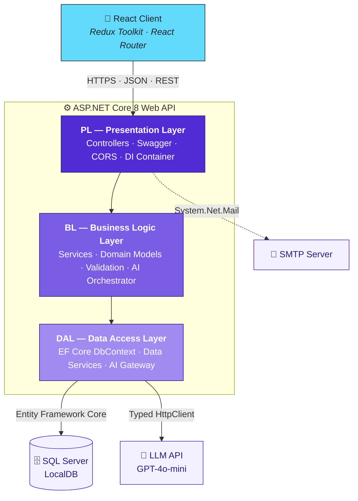
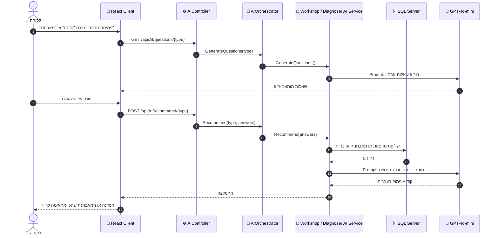
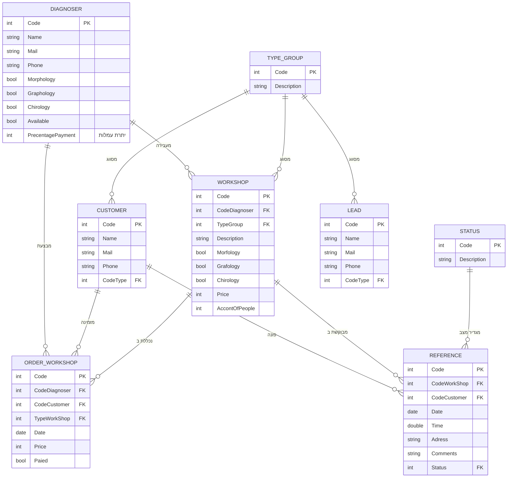
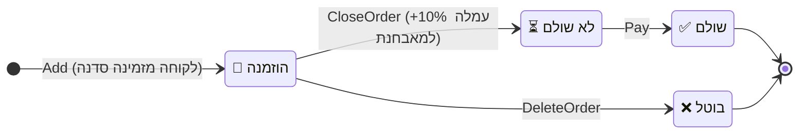

<div align="center">

# 🧠 Diagnoser — Server

### מערכת חכמה לניהול מאבחנות, סדנאות והזמנות, עם מנוע המלצות מבוסס AI

**RESTful Web API** · **N-Tier Architecture** · **LLM Integration**

<br/>


<br/>

[🎨 צד הלקוח (React)](https://github.com/Tauman-Chaya/React---Diagnoser) · [🏗️ ארכיטקטורה](#-ארכיטקטורה) · [🤖 מנוע ה-AI](#-מנוע-ההמלצות-מבוסס-ai) · [📡 API](#-api-reference) · [🚀 הרצה](#-התקנה-והרצה)

</div>

<br/>

<div dir="rtl">

## 📌 על הפרויקט

**Diagnoser** היא מערכת **Full-Stack** לניהול עסק של אבחונים וסדנאות בתחומי **מורפולוגיה**, **גרפולוגיה** ו**כירולוגיה**.
הריפו הזה הוא צד השרת: **Web API** ב-**ASP.NET Core 8**, שבנוי בארכיטקטורת שכבות נקייה ומשרת את [צד הלקוח ב-React](https://github.com/Tauman-Chaya/React---Diagnoser).

המערכת מלווה את כל התהליך: רישום מתעניינות ולקוחות, התאמת סדנה ומאבחנת בעזרת **בינה מלאכותית**, ועד ההזמנה, סגירת ההזמנה, התשלום וחישוב העמלות.

### ✨ יכולות מרכזיות

| | יכולת | תיאור |
|:---:|---|---|
| 🤖 | **המלצות AI** | שאלון חכם שה-**LLM** מייצר, והמלצה מותאמת אישית על סדנה או מאבחנת, על סמך הנתונים האמיתיים במסד |
| 👩‍⚕️ | **ניהול מאבחנות** | פרופיל, תחומי התמחות, זמינות, סינון רב-ממדי לפי תחום, ומעקב יתרות |
| 🎓 | **ניהול סדנאות** | קטלוג סדנאות לפי סוג קבוצה, תחום, מחיר וכמות משתתפות, וחיפוש מתקדם |
| 🧾 | **הזמנות והפניות** | יצירה, עדכון, סגירה וביטול, עם **ניהול סטטוסים** לאורך כל התהליך |
| 💰 | **תשלומים ועמלות** | חישוב אוטומטי של **10% עמלה** בסגירת הזמנה, ומעקב תשלומים למנהלת |
| 👥 | **לקוחות ולידים** | הרשמה עם ולידציה, סיווג לפי סוג קבוצה, ומעקב מתעניינות |
| 📧 | **שליחת מיילים** | שירות **SMTP** לשליחת הודעות HTML ללקוחות |
| 🔐 | **אבטחה** | מפתחות מחוץ לקוד (**User Secrets**), ו-**CORS Policy** שמאפשרת גישה רק לצד הלקוח |

<br/>

## 🏗️ ארכיטקטורה

המערכת בנויה ב-**N-Tier (Layered) Architecture**, עם **Separation of Concerns** מלא. כל שכבה מכירה רק את השכבה שמתחתיה, ומדברת איתה רק דרך **ממשקים (Interfaces)**.

</div>



<div dir="rtl">

### 🧩 השכבות

| שכבה | פרויקט | אחריות | דוגמאות מהקוד |
|---|---|---|---|
| **Presentation** | `PL` | קבלת בקשות HTTP, ניתוב, החזרת תשובות JSON, תיעוד **OpenAPI** | `WorkShopsController`, `AIController`, `Program.cs` |
| **Business Logic** | `BL` | כללים עסקיים, ולידציה, **מיפוי בין Entities ל-Domain Models**, תזמור ה-AI | `BLReferenceServices.CloseOrder`, `AIOrchestratorService` |
| **Data Access** | `DAL` | גישה למסד דרך **EF Core**, ושליחת בקשות לשירות ה-LLM | `DbManager`, `WorkshopServices`, `AIService` |

### 🎯 עקרונות ותבניות עיצוב

- **Generic CRUD Interfaces:** ‏`IcrudBL<T>` ו-`Icrud<T>` מגדירים חוזה אחיד (`Create`, `Read`, `Update`, `Delete`) לכל הישויות, כולל `Read(Func<T,bool>)` לשאילתות דינמיות.
- **Dependency Injection:** כל השירותים נרשמים ב-DI Container ומוזרקים דרך ה-Constructor, וכך אין תלות ישירה במימוש.
- **Manager / Facade Pattern:** ‏`BLManager` ו-`DalManager` מרכזים את כל השירותים של השכבה ומציגים נקודת גישה אחת.
- **Orchestrator Pattern:** ‏`AIOrchestratorService` מנתב בקשות AI לשירות המתאים (סדנה או מאבחנת), בעזרת `switch` expression.
- **DTO & Domain Models:** השכבות העליונות לא נחשפות לישויות של EF. כל שירות ב-BL ממפה `Entity ↔ BLModel`.
- **Typed HttpClient** דרך `IHttpClientFactory`, לתקשורת יעילה ובטוחה מול שירות ה-AI.
- **Custom Domain Exceptions:** ‏`SignInException`, ‏`ReferenceException` ו-`SigninWorkShopExeption` מבטאות שגיאות עסקיות בצורה ברורה.
- **Asynchronous Programming:** כל הקוד, מה-Controller ועד המסד, הוא `async/await`.
- **Configuration over Code:** מחרוזת החיבור, מפתח ה-AI ופרטי המייל נקראים מ-`appsettings.json` ומ-**User Secrets**, ולא נכתבים בקוד.

<br/>

## 🤖 מנוע ההמלצות מבוסס AI

הלב החדשני של המערכת. במקום שהלקוחה תחפש בעצמה בין עשרות סדנאות ומאבחנות, המערכת מנהלת איתה **שיחה קצרה** וממליצה לה על ההתאמה הטובה ביותר.

**איך זה עובד:**
1. **Dynamic Question Generation:** ה-LLM מייצר חמש שאלות אבחון, לפי סוג ההמלצה.
2. **Context Injection:** בזמן ההמלצה, השרת שולף את **הנתונים העדכניים מהמסד** (סדנאות או מאבחנות) ומשלב אותם ב-Prompt. כך ה-AI ממליץ רק על מה שבאמת קיים במערכת.
3. **Prompt Engineering:** הנחיות מדויקות לפורמט התשובה (קוד + נימוק), לשפה (עברית), וסינון שדות רגישים מהנימוק.
4. **Structured Response:** הקליינט מקבל קוד של סדנה או מאבחנת ונימוק אישי, ומציג אותם.

</div>



<div dir="rtl">

<br/>

## 🗄️ מבנה מסד הנתונים

מסד נתונים רלציוני ב-**SQL Server**, שממופה ל-C# בגישת **EF Core Database-First**, עם **Navigation Properties** בין הישויות. הסקריפט המלא, כולל נתוני דמה: [`Database/schema.sql`](Database/schema.sql).

</div>



<div dir="rtl">

<br/>

## 🔄 מחזור החיים של הזמנה

כל הזמנה עוברת בין סטטוסים שמוגדרים בטבלת `Statuses`. כשסוגרים הזמנה, המערכת **מחשבת אוטומטית עמלה של 10%** ממחיר הסדנה ומוסיפה אותה ליתרה של המאבחנת. כשהמאבחנת משלמת, היתרה מתעדכנת (`PayToManager`).

</div>



<div dir="rtl">

<br/>

## 📡 API Reference

תיעוד אינטראקטיבי מלא זמין ב-**Swagger UI** בכתובת `/swagger` כשהשרת רץ.

<details open>
<summary><b>🤖 AI</b> — <code>/api/AI</code></summary>

| Method | Endpoint | תיאור |
|:---:|---|---|
| `GET` | `/api/AI/questions/{type}` | יצירת שאלון חכם (`workshop` / `diagnoser`) |
| `POST` | `/api/AI/recommend/{type}` | המלצה מותאמת אישית לפי התשובות |

</details>

<details>
<summary><b>🎓 סדנאות</b> — <code>/api/WorkShops</code></summary>

| Method | Endpoint | תיאור |
|:---:|---|---|
| `GET` | `/api/WorkShops/ReadAll` | כל הסדנאות |
| `GET` | `/api/WorkShops/Read/{code}` | סדנה לפי קוד |
| `GET` | `/api/WorkShops/Get/{mail}` | הסדנאות של מאבחנת |
| `GET` | `/api/WorkShops/GetWorkShops/{m}/{g}/{c}/{typeGroup}` | חיפוש לפי תחום וסוג קבוצה |
| `GET` | `/api/WorkShops/GetLDiagnosers/{m}/{g}/{c}/{typeGroup}` | המאבחנות שמתאימות לחיפוש |
| `POST` | `/api/WorkShops/Add` | הוספת סדנה |
| `PUT` | `/api/WorkShops/Update` | עדכון סדנה |
| `DELETE` | `/api/WorkShops/Delete` | מחיקת סדנה |

</details>

<details>
<summary><b>👩‍⚕️ מאבחנות</b> — <code>/Diagnosers</code></summary>

| Method | Endpoint | תיאור |
|:---:|---|---|
| `GET` | `/Diagnosers/ReadAll` | כל המאבחנות |
| `GET` | `/Diagnosers/Read` | מאבחנת לפי קוד |
| `GET` | `/Diagnosers/GetDiagnosers/{c}/{g}/{m}` | סינון רב-ממדי לפי תחומי התמחות |
| `GET` | `/Diagnosers/AllMorfology` · `AllGrafology` · `AllChirology` | מאבחנות לפי תחום |
| `GET` | `/Diagnosers/AllAvailable` | מאבחנות זמינות |
| `GET` | `/Diagnosers/IsMorfology` · `IsGrafology` · `IsChirology` · `IsAvailable` | בדיקת התמחות וזמינות |
| `POST` | `/Diagnosers/Add` | הוספת מאבחנת |
| `POST` | `/Diagnosers/Update` | עדכון פרטים |
| `POST` | `/Diagnosers/PayToManager/{num}/{code}` | תשלום עמלה למנהלת |
| `DELETE` | `/Diagnosers/Delete` | מחיקה |

</details>

<details>
<summary><b>🧾 הזמנות והפניות</b> — <code>/References</code></summary>

| Method | Endpoint | תיאור |
|:---:|---|---|
| `GET` | `/References/ReadAll` | כל ההזמנות |
| `GET` | `/References/Read` | הזמנה לפי קוד |
| `GET` | `/References/GetWorkShop` · `GetDiagnoser` | הסדנה והמאבחנת של ההזמנה |
| `POST` | `/References/Add` | יצירת הזמנה |
| `PUT` | `/References/Update` | עדכון הזמנה |
| `PUT` | `/References/CloseOrder/{code}` | סגירת הזמנה וחישוב עמלה |
| `PUT` | `/References/Pay/{code}` | סימון כשולם |
| `PUT` | `/References/DeleteOrder` | ביטול הזמנה |
| `DELETE` | `/References/Delete` | מחיקה |

</details>

<details>
<summary><b>👥 לקוחות, לידים ונתוני מערכת</b></summary>

| Method | Endpoint | תיאור |
|:---:|---|---|
| `GET` | `/Customers/ReadAll` | כל הלקוחות |
| `POST` | `/Customers/Add` · `Update` · `Type` | הרשמה עם ולידציה, עדכון וזיהוי סוג משתמש |
| `DELETE` | `/Customers/Delete` | מחיקה |
| `GET` | `/Leads/ReadAll` | כל המתעניינות |
| `POST` | `/Leads/Add` · `Update` · `Type` | הוספה ועדכון |
| `DELETE` | `/Leads/Delete` | מחיקה |
| `GET` | `/Statuses/ReadAll` | סטטוסי הזמנה |
| `GET` | `/ReadAll` · `/GetCode/{name}` · `/GetName/{code}` | סוגי קבוצות |
| `POST` / `PUT` / `DELETE` | `/Create` · `/Update` · `/Delete` | ניהול סוגי קבוצות |
| `POST` | `/api/Email/SendEmail` | שליחת מייל HTML |

</details>

<br/>

## 🛠️ טכנולוגיות

| תחום | טכנולוגיה |
|---|---|
| **Framework** | ASP.NET Core 8 Web API, ‏C# 12 |
| **ORM** | Entity Framework Core 8 (Database-First, LINQ) |
| **Database** | Microsoft SQL Server (LocalDB) |
| **AI** | Large Language Model: ‏GPT-4o-mini דרך Chat Completions API |
| **Documentation** | Swagger / OpenAPI (Swashbuckle) |
| **Security** | .NET User Secrets, ‏CORS Policy, ‏HTTPS Redirection |
| **Communication** | REST, ‏JSON, ‏`IHttpClientFactory`, ‏SMTP |
| **Tools** | Visual Studio 2022, ‏Git, ‏GitHub |

<br/>

## 📂 מבנה הפרויקט

</div>

```text
Diagnoser-Server/
├── 📄 Morfology.sln
│
├── 🌐 PL/                         # Presentation Layer
│   ├── Controllers/               # AI, WorkShops, Diagnosers, References,
│   │                              # Customers, Leads, Statuses, TypeGroups, Email
│   ├── Program.cs                 # DI, CORS, Swagger, connection string
│   └── appsettings.json           # הגדרות (בלי סודות)
│
├── 🧠 BL/                         # Business Logic Layer
│   ├── API/                       # IcrudBL<T> + ממשקי השירותים
│   ├── Model/                     # Domain Models / DTOs
│   ├── Services/                  # לוגיקה עסקית + AI Orchestrator
│   ├── Exeptions/                 # Custom Domain Exceptions
│   └── BLManager.cs               # Facade לשכבה
│
├── 🗃️ Database/
│   └── schema.sql                 # טבלאות + נתונים קבועים + נתוני דמה
│
└── 🗄️ DAL/                        # Data Access Layer
    ├── Api/                       # Icrud<T> + IAIService
    ├── Models/                    # EF Core Entities + DbManager (DbContext)
    ├── Services/                  # גישה לנתונים + AIService (LLM Gateway)
    └── DalManager.cs              # Facade לשכבה
```

<div dir="rtl">

<br/>

## 🚀 התקנה והרצה

### דרישות מקדימות
- [.NET 8 SDK](https://dotnet.microsoft.com/download/dotnet/8.0)
- SQL Server LocalDB (מגיע עם Visual Studio)
- מפתח API לשירות AI תואם OpenAI

### 1. שכפול הריפו

</div>

```bash
git clone https://github.com/Tauman-Chaya/C----Diagnoser.git
cd C----Diagnoser
```

<div dir="rtl">

### 2. מסד הנתונים

הסקריפט [`Database/schema.sql`](Database/schema.sql) בונה את מסד הנתונים מאפס: את כל הטבלאות והקשרים, את הטבלאות הקבועות שהקוד תלוי בהן (סטטוסי הזמנה וסוגי קבוצות), ו**נתוני דמה** להדגמה (מאבחנות, סדנאות, לקוחות והזמנות בכל הסטטוסים).

</div>

```bash
sqlcmd -S "(localdb)\MSSQLLocalDB" -i Database\schema.sql
```

<div dir="rtl">

> 💡 אפשר גם בלי שורת פקודה: ב-Visual Studio פותחים **View ← SQL Server Object Explorer**, מתחברים ל-`(localdb)\MSSQLLocalDB`, פותחים את הקובץ ולוחצים **Execute**.

אחר כך מכוונים את השרת למסד החדש:

</div>

```bash
cd PL
dotnet user-secrets set "ConnectionStrings:DefaultConnection" "Server=(localdb)\MSSQLLocalDB;Database=Diagnoser;Trusted_Connection=True;TrustServerCertificate=True"
```

<div dir="rtl">

> 📁 יש לך כבר קובץ `MyData.mdf`? אפשר לוותר על השלבים האלה ולהניח אותו בתיקייה `Data` שליד `PL`. מחרוזת החיבור שב-`appsettings.json` משתמשת ב-`|DataDirectory|`, והשרת מוצא את התיקייה לבד.

### 3. הגדרת סודות (User Secrets)

המפתחות **לא נשמרים בקוד**. מגדירים אותם פעם אחת במחשב:

</div>

```bash
cd PL
dotnet user-secrets set "AI:ApiKey" "<your-api-key>"

# אופציונלי – לשליחת מיילים
dotnet user-secrets set "Email:UserName" "<your-email>"
dotnet user-secrets set "Email:Password" "<your-app-password>"
```

<div dir="rtl">

### 4. הרצה

</div>

```bash
dotnet run --project PL
```

<div dir="rtl">

פותחים את Swagger בכתובת **https://localhost:7082/swagger**.

כדי להפעיל את המערכת המלאה, מריצים גם את [צד הלקוח](https://github.com/Tauman-Chaya/React---Diagnoser) (`http://localhost:3000`). השרת מוגדר לקבל ממנו בקשות (CORS).

<br/>

## 🔗 פרויקטים קשורים

| | ריפו | תיאור |
|:---:|---|---|
| ⚙️ | **[C----Diagnoser](https://github.com/Tauman-Chaya/C----Diagnoser)** | צד השרת: ASP.NET Core Web API *(אתם כאן)* |
| 🎨 | **[React---Diagnoser](https://github.com/Tauman-Chaya/React---Diagnoser)** | צד הלקוח: React 18, ‏Redux Toolkit, יומן עברי, בוט AI |

<br/>

<div align="center">

---

### 👩‍💻 פותח על ידי **חיה טאומן** ו**מלי אורלינסקי**

[](https://github.com/Tauman-Chaya)
[](https://github.com/Maly-Orlinsky)

⭐ אם הפרויקט מצא חן בעינייך, אשמח לכוכב!

</div>

</div>
